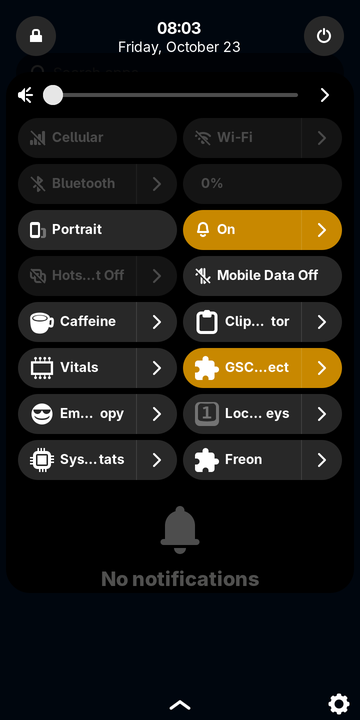
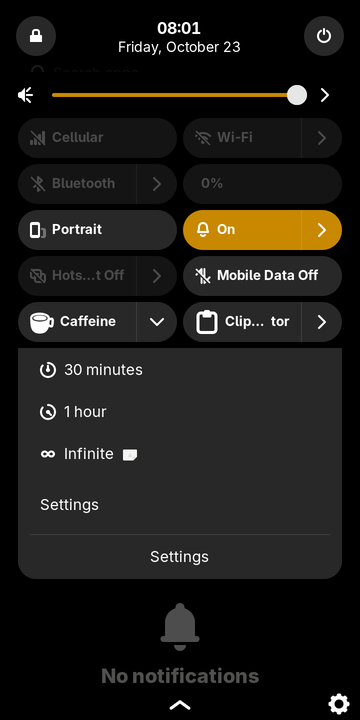
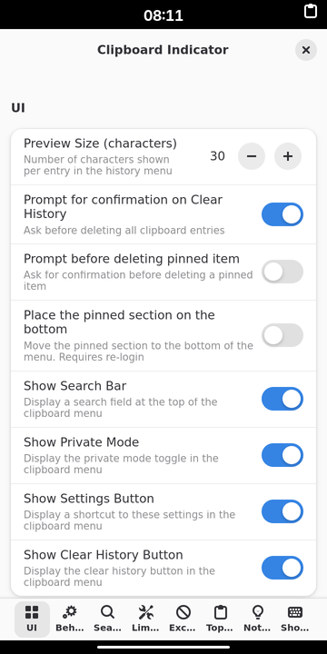

# gnosh

**Run GNOME Shell extensions in Phosh.**

gnosh runs GNOME Shell extensions in [Phosh](https://phosh.mobi), the GNOME
mobile shell. Panel indicators appear in Phosh's top bar. Their menus,
quick toggles and sliders become native Phosh quick-settings tiles, and
their dialogs and notifications use Phosh's own. You can install extensions
with the `gnosh` command, with [Extension Manager] or with
[gnome-extensions-cli] (`gext`), and their preferences open as usual.

It only works in Phosh. It is not a GNOME Shell replacement and does nothing
in GNOME, KDE or other desktops.

<p align="center">
  
  
  
</p>

* Website and docs: <https://exynos-linux.github.io/gnosh/>
* Tested extensions: [compatibility matrix](https://exynos-linux.github.io/gnosh/compatibility.html)
  (generated from [`tests/results/extensions.json`](tests/results/extensions.json))

## Install

From a Phosh session (or over ssh as the Phosh user):

```sh
curl -fsSL https://raw.githubusercontent.com/exynos-linux/gnosh/main/setup.sh | sh
```

or from git:

```sh
git clone https://github.com/exynos-linux/gnosh
cd gnosh
./setup.sh
```

Then log out and back in (or reboot). `setup.sh` installs for your user only,
under `~/.local` and `~/.config` plus `flatpak --user`, so it never needs root
and also works on immutable systems such as postmarketOS Duranium. It installs:

* the gnosh runtime and the `gnosh` command,
* a small GTK module that loads gnosh into Phosh, enabled by a systemd user
  drop-in for `mobi.phosh.Shell.service`,
* [Extension Manager], from Flathub with `flatpak --user` unless your
  distribution already provides it,
* [gnome-extensions-cli] (`gext`), in a private Python virtualenv,
* a daily update timer for gnosh and your extensions (`--no-auto-update` skips it).

Run `./setup.sh --help` for options, and `./setup.sh --uninstall` to remove
gnosh. Uninstalling keeps your extensions and settings.

## Use

```sh
gnosh install clipboard-indicator@tudmotu.com   # uuid, extensions.gnome.org URL, search term or .zip
gnosh install caffeine
gnosh list -v                  # what is installed and what state it is in
gnosh disable caffeine@patapon.info --phosh-only   # keep it on in GNOME, off in Phosh
gnosh prefs clipboard-indicator@tudmotu.com
gnosh update                   # newer extension versions from extensions.gnome.org
gnosh doctor                   # check the installation
gnosh self-update              # newest gnosh release from GitHub
gnosh status | log | search | info | config | shell
```

Extensions you install while Phosh runs load immediately, whether you use
`gnosh install`, `gext` or Extension Manager. Updated extensions run after the
next login, because GNOME Shell extensions are ES modules and can't be
re-imported into a running shell (GNOME Shell has the same limitation).

gnosh uses GNOME's own settings and folders: `org.gnome.shell
enabled-extensions` and `~/.local/share/gnome-shell/extensions`. On a device
that can boot either GNOME or Phosh, an extension enabled in one is enabled
in the other. Use `--phosh-only` to keep an extension off in Phosh only.

## How it works

GNOME Shell extensions are JavaScript (GJS) that runs *inside* gnome-shell.
They import gnome-shell's own modules (`resource:///org/gnome/shell/ui/main.js`,
`popupMenu.js`, `quickSettings.js`, ...) and the private toolkits St, Clutter,
Meta and Shell, and they add widgets to the shell's scene graph. Phosh is a
separate C/GTK 3 shell on the phoc compositor, so none of that exists there.
gnosh provides it:

```
                 phosh process (stock /usr/libexec/phosh)
 ┌──────────────────────────────────────────────────────────────────────────┐
 │ GTK_MODULES=libgnosh-phosh.so  ── loads libgjs, runs the gnosh runtime    │
 │                                                                          │
 │  extension.js / stylesheet.css (unchanged, from extensions.gnome.org)    │
 │        │  import 'resource:///org/gnome/shell/ui/…'   'gi://St' …        │
 │        ▼                                                                 │
 │  GNOME Shell 50 JS (popupMenu, panelMenu, quickSettings, extension       │
 │  system, …, GPL-2.0+, reused)  +  gnosh replacements (main, panel,       │
 │  layout, messageTray, modalDialog, …)                                    │
 │        │                                                                 │
 │        ▼                                                                 │
 │  St / Clutter / Meta / Shell implemented on GTK 3 (runtime/gi)           │
 │        │                                                                 │
 │        ▼  bridge (runtime/shell/bridge.js)                               │
 │  Phosh widgets: top bar status box · PhoshQuickSetting tiles ·           │
 │  PhoshStatusPage · PhoshSystemModalDialog · Phosh notifications · OSD    │
 └──────────────────────────────────────────────────────────────────────────┘
        ▲ D-Bus: org.gnome.Shell.Extensions (Extension Manager, gext, gnome-extensions)
        ▲ D-Bus: io.github.exynos_linux.Gnosh (gnosh CLI)
```

* **Inside Phosh, not next to it.** gnosh is a tiny GTK module, with no
  link-time dependencies and one binary per CPU, that starts GJS inside the
  stock Phosh process. Extensions can then put real widgets into Phosh's top
  bar and quick settings. Phosh's own plugins keep working, and nothing in
  `/usr` changes. A crash guard falls back to plain Phosh if Phosh dies twice
  before gnosh has been up for 45 seconds.
* **St and Clutter on GTK 3.** `gi://St`, `gi://Clutter`, `gi://Meta`,
  `gi://Shell`, `gi://Mtk` and `gi://Cogl` resolve to gnosh's JavaScript
  implementation. Small generated typelibs reserve the namespaces. Every
  actor is a real GObject that extensions can subclass, backed by GTK
  widgets. The layout managers, events and `vfunc_*` overrides, the gestures
  (`Clutter.ClickGesture`, `PanGesture`), styling (`style_class`, inline
  `style`, `stylesheet.css` translated to GTK CSS), icons, entries, scroll
  views and drawing areas behave like Clutter's.
* **GNOME's own UI code.** Popup menus, panel buttons, quick toggles,
  sliders and the extension manager are GNOME Shell 50's own JavaScript. They
  run unchanged on the emulated toolkit, so extensions that subclass
  `PopupBaseMenuItem` or `QuickMenuToggle` get the behaviour they expect.
* **Mapped onto Phosh:**

  | GNOME Shell | in Phosh |
  |---|---|
  | `Main.panel.addToStatusArea()` indicator | Phosh top bar (status icon area) **and** a quick settings tile whose status page shows the indicator's menu |
  | `QuickToggle`, `QuickMenuToggle`, `SystemIndicator` | Phosh quick settings tile (on/off, title, icon); the menu is shown in the tile's status page; indicator icons go to the top bar |
  | `QuickSlider` | tile with the slider in its status page |
  | `MessageTray.Source/Notification`, `Main.notify` | Phosh notifications (org.freedesktop.Notifications), including actions |
  | `ModalDialog` | Phosh system modal dialog |
  | `Main.osdWindowManager` | Phosh OSD |
  | `Main.wm.addKeybinding`, `global.display.grab_accelerator` | Phosh's accelerator grabs (hardware keyboards) |
  | `St.Clipboard`, `global.display.get_selection()` | GTK clipboard of the Phosh process |
  | `global.display` windows, fullscreen state | toplevels from Phosh's overview (app id, fullscreen, maximized) |
  | screen lock | `Main.sessionMode` switches to `unlock-dialog`; extensions without that session mode are disabled while locked, as in GNOME |
  | `prefs.js` | gnosh's prefs host (GTK 4 / libadwaita), opened by Extension Manager, the tile's Settings button or `gnosh prefs` |
  | extension management D-Bus API | `org.gnome.Shell.Extensions`, on its own bus name and on Phosh's `org.gnome.Shell` connection |

## What works, what doesn't

See the **[compatibility matrix](https://exynos-linux.github.io/gnosh/compatibility.html)**
for every extension tested, with screenshots. In short:

* **Works:** panel indicators with menus (System Monitor, Vitals, Freon,
  Clipboard Indicator, Emoji Copy, Places, Removable Drives, Lock Keys,
  Executor, …), quick settings toggles and menus (Caffeine, GSConnect's
  toggle, Bluetooth Quick Connect, …), notifications, dialogs, preferences,
  settings and translations. Keybindings are implemented through Phosh's
  accelerator grabs but have not been tested with a hardware keyboard yet.
* **Partly:** features that need things Phosh doesn't expose. Window focus
  isn't known, clipboard *monitoring* only sees changes while Phosh has
  keyboard focus (for example while the quick settings drawer is open), there
  are no free-floating overlays (`Main.layoutManager.addChrome`) and no
  animations (they jump to the end state). XEmbed tray icons can't work
  (no X11). GSConnect's own notification replies don't work because Phosh
  runs its own notification server.
* **Not supported (refused with a reason):** extensions that change GNOME
  Shell's own UI or the compositor, which Phosh doesn't have: Dash to Dock,
  Dash to Panel, Blur my Shell, Just Perfection, ArcMenu, Quick Settings
  Tweaks, window tiling and workspace extensions, shell themes and window
  effects. The list is in [`runtime/data/compat.json`](runtime/data/compat.json).
  `gnosh config allow-unsupported true` loads them anyway, at your own risk.

gnosh implements the extension API of **GNOME Shell 50** and loads
extensions made for GNOME Shell **45 to 51**, the ES module era. Older
(GNOME ≤ 44) extensions are not supported.

## Distributions

gnosh needs a GTK 3 Phosh (all current releases), gjs ≥ 1.74, python3
for the `gnosh` command, and `glib-compile-schemas` for extensions with
settings. It doesn't use libphosh. Phosh is started through
`mobi.phosh.Shell.service` (Phosh ≥ 0.44) or `sm.puri.Phosh.service` (older).
gnosh adds a user drop-in to either one.

| Distribution | Phosh | gjs | Status |
|---|---|---|---|
| postmarketOS / Nura edge (systemd) | 0.58 | 1.90 | **tested**: headless and nested Phosh in a container (see the matrix) |
| postmarketOS v26.06, v25.12 (systemd) | 0.55, 0.51 | 1.88, 1.86 | expected to work (not tested) |
| postmarketOS with OpenRC | any | | experimental: the CLI writes an override of `mobi.phosh.Shell.desktop` instead of a systemd drop-in (not tested) |
| Debian 13 trixie, Mobian trixie | 0.46 | 1.82 | expected to work (not tested) |
| Debian forky/sid, Mobian staging | 0.58 | 1.90 | expected to work (not tested) |
| Fedora 43, 44, rawhide | 0.54–0.57 | 1.86–1.90 | expected to work (not tested) |
| Arch Linux ARM | 0.57 | 1.90 | expected to work (not tested) |
| Ubuntu 26.04 | 0.54 | 1.88 | expected to work (not tested) |
| PureOS crimson, Manjaro ARM stable | 0.34, 0.37 | 1.74, 1.78 | unknown: old gjs (GNOME 50 JS may use newer language features) |

The module is prebuilt for **x86_64, aarch64, armv7l and riscv64**. It works
with glibc and musl alike.

## Safety

* gnosh runs inside Phosh. If an extension throws an exception, gnosh logs
  it and marks the extension as failed, and Phosh keeps running. A segfault
  in Phosh would end the session, so the GTK module counts starts that
  never became stable. After two of them gnosh stays out of Phosh until you
  run `gnosh shell reset` or log in again.
* `gnosh shell disable` (or `./setup.sh --uninstall`) removes the drop-in, and
  the next login runs plain Phosh. `touch ~/.config/gnosh/disabled` does the
  same without uninstalling.
* Extensions are code that runs in your shell, as in GNOME. Install the ones
  you trust.

## Development

```sh
make module                    # build the Phosh module for this machine
make test                      # lint, unit tests, prebuilt-module check
podman build -t gnosh-test-pmos -f tests/container/Containerfile.pmos tests/container
tests/integration/run-nested.sh /tmp/out tests/integration/steps/official.sh   # headless Phosh + screenshots
tests/integration/container-run.sh tests/integration/test-setup.sh /tmp/out   # setup.sh as a new user
tests/integration/matrix.sh tests/cache/ext /tmp/matrix                       # one Phosh per extension
```

* `src/module/` is the GTK module (C, about 200 lines).
* `runtime/shell/` holds the bootstrap, the Phosh bridge, D-Bus services, `global`, the environment
  setup and an in-memory GResource builder.
* `runtime/gi/` holds St, Clutter, Meta, Shell, Mtk and Cogl on GTK 3.
* `runtime/shim/org/gnome/shell/` holds the modules extensions import. GNOME Shell 50 files are marked
  "copied from GNOME Shell 50"; the rest are gnosh's.
* `runtime/prefs/` is the preferences host.
* `bin/gnosh` is the command (Python 3, standard library only).
* `setup.sh` is the installer.
* `site/` and `tools/build-site.py` build the website.

gnosh is free software under the GNU GPL, version 3 or later. It includes
code from GNOME Shell (GPL-2.0-or-later).

[Extension Manager]: https://github.com/mjakeman/extension-manager
[gnome-extensions-cli]: https://github.com/essembeh/gnome-extensions-cli
